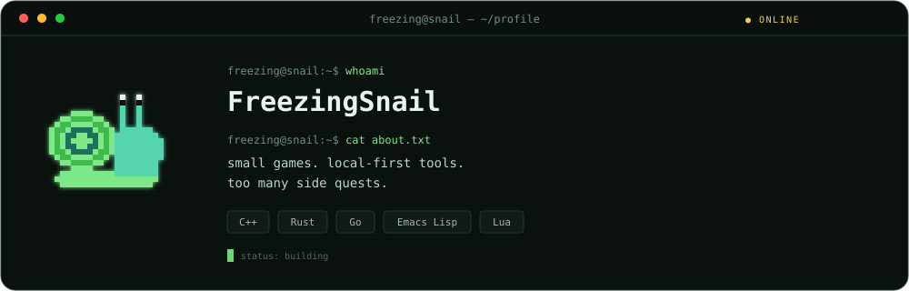
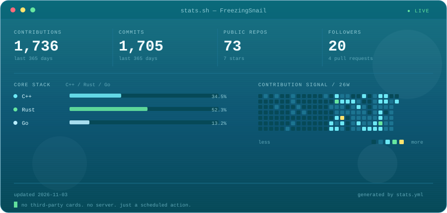

  

### `$ whoami`

I make small games, local-first tools, and machines that keep track of themselves. Most of it fits in a terminal, a pocket, or an Arduboy.

- `now` — [maduin](https://github.com/FreezingSnail/maduin) — Emacs-native crew/fleet orchestrator for opencode + DeepSeek
- `also` — [chaplet](https://github.com/FreezingSnail/chaplet) — magit-style Emacs interface for the `bd` issue tracker
- `play` — [CreatureGathererFX](https://github.com/FreezingSnail/CreatureGathererFX) / [Maze-Rider](https://github.com/FreezingSnail/Maze-Rider) — Arduboy games
- `notes` — [wobpager](https://freezingsnail.github.io/) — notes from beneath the surface

---

## `$ ls ~/featured`

| project | what | stack |
|---|---|---|
| **[CreatureGathererFX](https://github.com/FreezingSnail/CreatureGathererFX)** | Creature-collecting demake for the Arduboy. | `C++` |
| **[Maze-Rider](https://github.com/FreezingSnail/Maze-Rider)** | Maze crawler where you hunt for parts of a unicycle. | `C` |
| **[maduin](https://github.com/FreezingSnail/maduin)** | Emacs-native crew/fleet orchestrator wrapping opencode + DeepSeek. | `Emacs Lisp` |
| **[chaplet](https://github.com/FreezingSnail/chaplet)** | A magit-style Emacs interface for the `bd` issue tracker. | `Emacs Lisp` |
| **[agalma](https://github.com/FreezingSnail/agalma)** | Always-running software factory. | `Rust` |
| **[mhfu-set-searcher](https://github.com/FreezingSnail/mhfu-set-searcher)** | MHFU armor set solver, builder, and weapon tree search. | `TypeScript` |

More at [github.com/FreezingSnail?tab=repositories](https://github.com/FreezingSnail?tab=repositories).

---

## `$ ./stats.sh`

  

Generated daily from the GitHub API by [`scripts/stats.mjs`](scripts/stats.mjs) and a scheduled [GitHub Action](.github/workflows/stats.yml). No third-party cards, no server. Palette: Frutiger Aero.

---

## `$ cat ~/.stack`

`C++` · `Rust` · `Go` · `TypeScript` · `Emacs Lisp` · `Lua` · `Shell`

Antarctica · [wobpager](https://freezingsnail.github.io/) · [github.com/FreezingSnail](https://github.com/FreezingSnail)

Snailware logo © 2023 Freezing Snail, [MIT licensed](assets/LICENSE-AllYourArdu.txt). Palette: my Frutiger Aero Alacritty theme.
